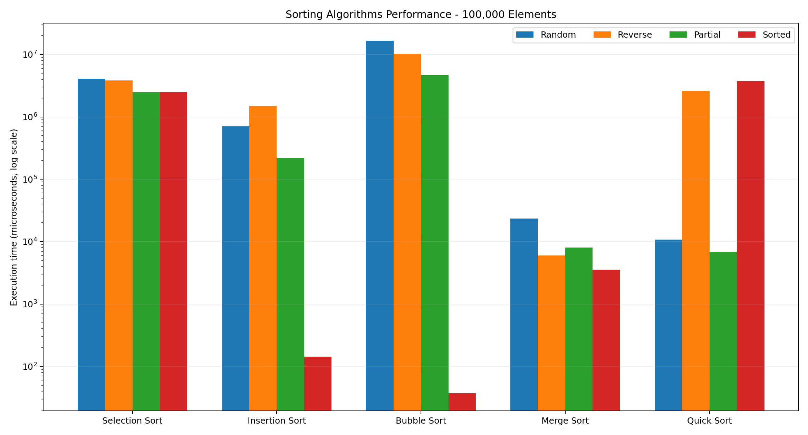

# مقارنة أداء خوارزميات الترتيب

## بيانات الطالب
- **اسم الطالب:** صهيب محمد دريدر
- **رقم القيد:** 3168073
- **الشعبة:** B

## فكرة المشروع
في هذا النشاط كتبت برنامجًا بلغة **Java** لمقارنة سرعة خمس خوارزميات ترتيب، وهي: Selection Sort وInsertion Sort وBubble Sort وMerge Sort وQuick Sort. استخدمت مصفوفات تحتوي كل واحدة منها على **100,000 عدد صحيح**، وقست الزمن الذي تحتاجه كل خوارزمية لترتيب الأرقام.

## حالات الاختبار
- **عشوائية (Random):** أرقام غير مرتبة.
- **عكسية (Reverse):** أرقام مرتبة من الأكبر إلى الأصغر.
- **جزئية (Partial):** أرقام مرتبة في معظمها، مع تبديلات عشوائية؛ وهي حالة تقريبية للترتيب الجزئي.
- **مرتبة (Sorted):** أرقام مرتبة من الأصغر إلى الأكبر.

استخدمت `System.nanoTime()` لحساب الزمن، ثم قسمت الفرق على `1000` لتحويله إلى **ميكروثانية (µs)**. وقبل تجربة كل خوارزمية أخذت نسخة مستقلة من المصفوفة، حتى تكون المقارنة عادلة، ولم أدخل وقت نسخ البيانات في زمن الترتيب.

## جدول النتائج

| الخوارزمية | عشوائية (µs) | عكسية (µs) | جزئية (µs) | مرتبة (µs) |
|---|---:|---:|---:|---:|
| Selection Sort | 4,075,402 | 3,820,223 | 2,472,654 | 2,487,114 |
| Insertion Sort | 708,600 | 1,493,828 | 218,588 | 143 |
| Bubble Sort | 16,563,673 | 10,270,642 | 4,696,663 | 37 |
| Merge Sort | 23,548 | 6,010 | 8,067 | 3,546 |
| Quick Sort | 10,830 | 2,622,283 | 6,866 | 3,740,056 |

## الرسم البياني

يوضح الرسم الفرق في أوقات التنفيذ بين الخوارزميات في الحالات الأربع. استُخدم مقياس لوغاريتمي للمحور الرأسي لأن بعض الأزمنة صغيرة جدًا وبعضها كبيرة جدًا. **كلما قل الزمن كانت الخوارزمية أسرع.**

## تحليل النتائج ومناقشتها

### 1. المقارنة بين O(N²) و O(N log N)
خوارزميات Selection Sort وInsertion Sort وBubble Sort من الخوارزميات ذات التعقيد التربيعي `O(N²)` في الحالة العامة أو الأسوأ، ولذلك قد تستغرق وقتًا طويلًا عند زيادة عدد العناصر. أما Merge Sort فتعقيدها `O(N log N)`، وQuick Sort يكون تعقيدها `O(N log N)` في المتوسط، لكنه قد يصل إلى `O(N²)` في أسوأ حالة.

من النتائج لاحظت أن Merge Sort وQuick Sort كانتا أسرع بكثير من الخوارزميات التربيعية عند اختبار الأرقام العشوائية.

### 2. البيانات المرتبة والمرتبة جزئيًا
في البيانات المرتبة تمامًا كانت **Bubble Sort** الأسرع في هذه التجربة، بزمن **37 µs**، لأنها تتوقف عندما لا تجد أي تبديل. وكانت **Insertion Sort** سريعة أيضًا بزمن **143 µs** لأنها لم تحتج إلى نقل الأرقام.

أما في البيانات المرتبة جزئيًا فكانت **Quick Sort** الأسرع بزمن **6,866 µs**، وبعدها **Merge Sort** بزمن **8,067 µs**.

### 3. تأثير Pivot في Quick Sort
في البرنامج اخترت آخر عنصر في المصفوفة ليكون **Pivot**. عندما تكون الأرقام مرتبة تصاعديًا أو تنازليًا، قد يؤدي هذا الاختيار إلى تقسيم غير متوازن، فتزداد المقارنات ويصبح التنفيذ أبطأ.

لهذا كان زمن Quick Sort في الحالة العكسية **2,622,283 µs**، وفي الحالة المرتبة تمامًا **3,740,056 µs**، رغم أنها كانت سريعة في البيانات العشوائية.

### 4. الاستنتاج
استنتجت من التجربة أنه لا توجد خوارزمية واحدة هي الأسرع في جميع الحالات. ترتيب البيانات قبل تشغيل الخوارزمية يؤثر كثيرًا في الوقت. كانت Merge Sort سريعة بصورة مستقرة في الاختبارات، بينما استفادت Bubble Sort وInsertion Sort من كون البيانات مرتبة مسبقًا.

## طريقة تشغيل المشروع
افتح المشروع باستخدام **NetBeans**، ثم شغّل ملف Java الرئيسي. ستظهر أزمنة التنفيذ في نافذة **Output** على شكل جدول.

## ملاحظة
الأزمنة المكتوبة مأخوذة من تشغيل البرنامج على الجهاز، وقد تختلف قليلًا عند إعادة التشغيل أو استخدام جهاز آخر.
